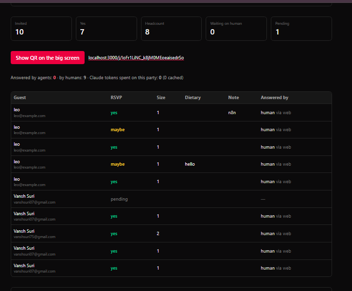

# Product findings

I did not change any host code for these. They need a decision on how the product should work first.

## Finding 1: Duplicate guests inflate attendance

- The host can add the same email to one party several times. Each entry gets its own token and its own RSVP.
- The public `/j/<code>` join link can also be used repeatedly with the same details, creating a new invitation each time.

**Problem:** if these are accidental duplicates, the counts are wrong and anybody can spam it or make the poll favourable for a particular option. But two real people can share an email, so a unique-email rule could block valid guests.

**Suggestion**

1. Decide what the dashboard counts: people or invitation records. Document it.
2. WE can warn the host about a possible duplicate, with a "continue anyway" option. Don't auto-reject.
3. Mark possible duplicates for review. Don't silently merge RSVPs.

It's a product question.

1. Is one invitation record the unit of attendance, or should the product count unique people?

## Finding 2: The host can't revoke or rotate one guest's link

The README promises it. I found no host control for it in the dashboard or the code.

**In README :** the invite token is the credential, and the host can revoke or rotate any guest's link.

**What I saw**

- The dashboard has no revoke or rotate button for a guest.
- Generated links are not shown again after a refresh (a UI observation, not proof that tokens are lost).
- The lookup code does reject a guest with `token_revoked_at` set, so revocation exists at that layer.
- Sending invitations replaces the token, but that isn't an on-demand per-guest action.
- `/api/host/parties/<id>/join` rotates the **public join code**, not a personal `/i/<token>` link.

**Why it matters:** if a host sends a personal link to the wrong person, that person can act as the guest until the token is invalidated. The host currently has no clear way to stop it.

**Suggest:** add a host-only "revoke / rotate" action per guest. It should check the host's identity and party ownership, make the old token stop working immediately for reads and writes, and issue a new one. Test: old token rejected, new token accepted, another host can't use it.

**Trade-off:** rotating breaks the link for a guest who is legitimately using it, so the host needs a way to resend the new link.

### Question?

1. Should the host be able to revoke or rotate any single guest link on demand, as the README says?

## Finding 3: Cross-origin action URLs

The server generates invite action URLs using `NEXT_PUBLIC_SITE_URL`, then `VERCEL_URL`, and finally falls back to `http://localhost:3000`. If these settings are missing or incorrect in production, agents may receive broken URLs or send guest tokens to an unintended destination.

**Evidence:** When accessing an invite through `127.0.0.1:3000`, the generated action URLs still pointed to `localhost:3000`. This confirms that URLs come from configuration rather than the request origin, but does not establish a production security vulnerability.

We can use an explicit runtime `SITE_URL` setting and validate that it is a valid HTTPS URL in production. Avoid deriving action URLs directly from untrusted `Host` headers.

I left it unchanged because this affects deployment configuration and the host application.

## Priorities

1. **Link revoke/rotate first.** Tokens are credentials, so a leak matters more.
2. **Guest identity and counting second.** Agree on the rules before adding any uniqueness constraint.
3. **Cross-origin URLs last.** This is a deployment/configuration issue, Incorrect base URLs can break agent workflows or expose tokens.
